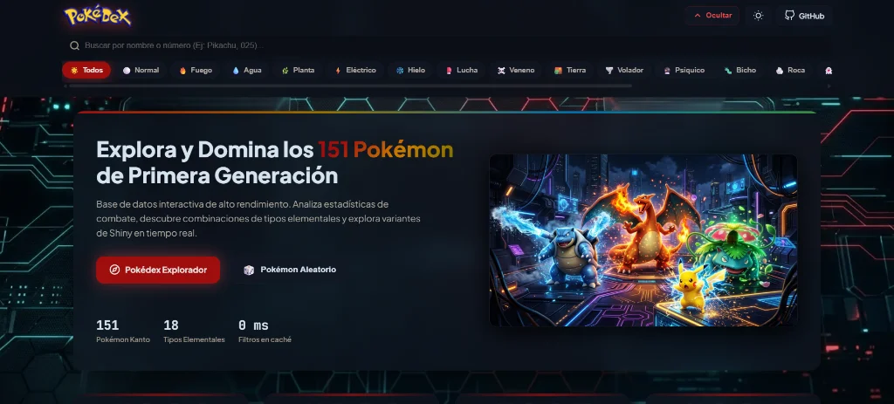

# ⚡ Pokédex Next-Gen

<p align="center">
  <a href="https://frankusqabant.github.io/PokeAPI/" target="_blank" rel="noopener noreferrer">
    
  </a>
</p>

<p align="center">
  <a href="https://frankusqabant.github.io/PokeAPI/"><b>🌐 Ver el sitio en vivo</b></a>
</p>

Pokédex de los **151 Pokémon de Kanto**, con modelos 3D que se mueven, hecha con HTML, CSS y JavaScript puro (sin frameworks).

## ✨ Qué tiene

- 🎬 **Hero animado:** los starters y Pikachu en 3D, con paralaje al mover el cursor.
- 🃏 **Tarjetas con vida:** al apuntar una, su Pokémon se anima, la tarjeta se inclina y brilla.
- 🔍 **Búsqueda y filtros por tipo** al instante, con modal de estadísticas y versión Shiny.
- 🌓 **Tema oscuro/claro**, teclado completo y respeto a `prefers-reduced-motion`.

## 🚀 Cómo es tan rápido

- **El 3D no se calcula en tu dispositivo.** Los modelos se renderizan una sola vez en GitHub Actions y la web solo muestra imágenes WebP animadas (sin WebGL en vivo).
- Los datos de los 151 están en `data/pokedex.json`: **0 peticiones a PokéAPI** al cargar (queda como respaldo).
- El reposo de cada tarjeta pesa ~10 KB; el loop animado se descarga solo al apuntarla. Los loops del hero se piden cuando la página ya cargó y se omiten con ahorro de datos o conexión lenta.

## 🗂️ Estructura

```text
index.html · css/ · js/        Sitio
data/pokedex.json              Datos de los 151 (scripts/build_data.mjs)
img/3d/                        Reposo (s/), loops animados y hero
.github/workflows/deploy.yml   Despliegue en GitHub Pages
```

Los renders 3D ya vienen hechos. Las herramientas de render y los `.glb` originales se retiraron del repo; siguen en el historial de git (commit `0429161`) y los modelos en [Pokemon 3D API](https://github.com/Pokemon-3D-api/assets).

## 📄 Créditos y licencia

- Datos: [PokéAPI](https://pokeapi.co/). Modelos 3D: [Pokémon 3D API](https://github.com/Pokemon-3D-api/assets) (originales de terceros en Sketchfab).
- Proyecto personal, sin fines comerciales. Pokémon y sus personajes son marcas de Nintendo, Game Freak y Creatures Inc.
- Código bajo licencia [MIT](LICENSE).
